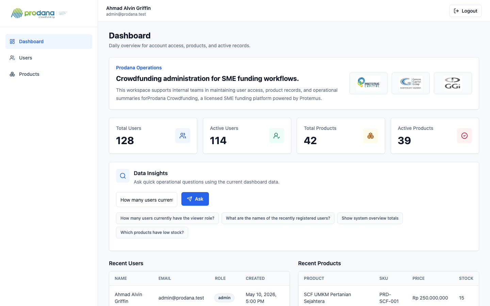
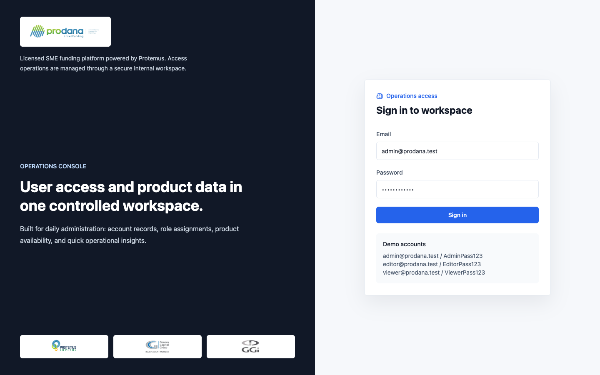
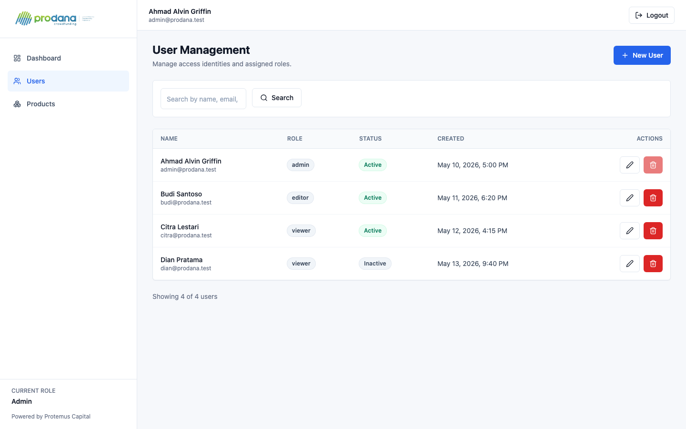
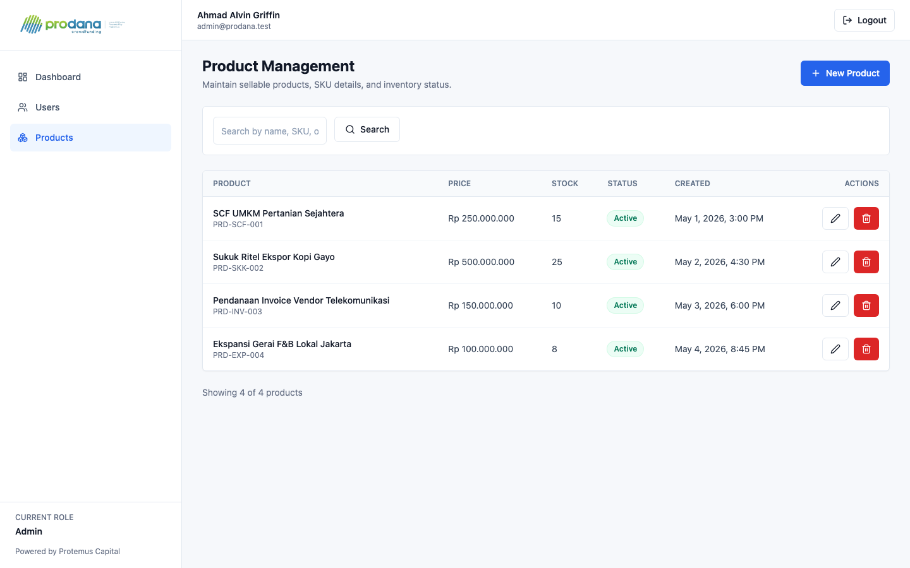

# 🛡️ Prodana RBAC Dashboard
### Enterprise Role-Based Access Control System • React • Vite • Node.js • Express • MySQL • Prisma • Tailwind CSS

Dashboard operasional berbasis peran (*Role-Based Access Control / RBAC*) yang dikembangkan untuk manajemen akses pengguna, keamanan data, dan pemeliharaan katalog produk UKM berlisensi pada platform **Prodana Crowdfunding** (didukung oleh *Protemus Capital*).

Aplikasi mengimplementasikan pemisahan hak akses granular (*Admin, Editor, Viewer*) di sisi antarmuka pengguna (*Frontend Guards*) maupun validasi ketat di sisi API endpoint (*Backend Middlewares*).

---

## 📸 Preview & Screenshots

### 📊 Operations Dashboard
<p align="center">
  
</p>

---

### 🔐 Authentication & Workspace Login
<p align="center">
  
</p>

---

### 👥 User Access & Identity Management
<p align="center">
  
</p>

---

### 📦 SME Product & Funding Records
<p align="center">
  
</p>

---

## 🔐 Matriks Hak Akses (Role-Based Permissions)

Sistem membagi pengguna ke dalam 3 peran terdefinisi:

| Fitur / Tindakan | Administrator | Editor | Viewer |
| :--- | :---: | :---: | :---: |
| **Akses Dashboard Ringkasan** | ✅ Full | ✅ Full | ✅ Full |
| **Lihat Daftar Pengguna (Users)** | ✅ Full | ✅ Full | ✅ Full |
| **Tambah / Edit / Hapus Pengguna** | ✅ Full | ✅ Full | ❌ Akses Ditolak |
| **Lihat Katalog Produk UKM (Products)** | ✅ Full | ❌ Tidak Muncul | ❌ Tidak Muncul |
| **Kelola Produk (Tambah/Edit/Hapus)** | ✅ Full | ❌ Tidak Muncul | ❌ Tidak Muncul |
| **Asisten Query & Data Insights** | ✅ Full | ✅ Full | ✅ Full |

---

## ✨ Fitur Utama

- **🛡️ End-to-End RBAC Protection**: Rute antarmuka diproteksi oleh `ProtectedRoute`, sementara API diproteksi oleh middleware verifikasi token JWT dan validator izin peran.
- **📈 Realtime Overview Cards**: Metrik ringkasan jumlah pengguna aktif/non-aktif dan produk aktif/non-aktif.
- **💬 Natural Data Query Assistant**: Fitur tanya jawab cepat terkait data operasional dashboard terkini.
- **🔍 Filter & Pencarian Cepat**: Pencarian dinamis untuk data pengguna dan produk berdasarkan nama, email, SKU, maupun role.
- **🗃️ Monorepo Architecture**: Struktur modular terorganisir dengan pemisahan jelas antara `backend/` (Node.js/Express/Prisma) dan `frontend/` (React/Vite/Tailwind).

---

## 🛠️ Tech Stack & Bahasa Pemrograman

| Layer | Teknologi | Peran & Deskripsi |
| :--- | :--- | :--- |
| **Bahasa Pemrograman** | `JavaScript (ES6+)`, `Node.js` | Digunakan secara konsisten untuk backend dan frontend |
| **Frontend Framework** | `React 18`, `Vite` | SPA dengan rendering cepat, modul HMR, dan routing React Router v6 |
| **Styling & UI** | `Tailwind CSS`, `Lucide Icons` | Tampilan korporat modern berbasis token warna Slate, Ink, dan Brand |
| **Backend Framework** | `Express.js 5` | RESTful API server dengan modular routing dan middleware arsitektur |
| **Database & ORM** | `MySQL / MariaDB`, `Prisma ORM` | Skema database relasional type-safe dengan migrasi & seeder otomatis |
| **Keamanan & Autentikasi**| `JSON Web Token (JWT)`, `bcryptjs` | Token bearer stateless dan hashing kata sandi aman |
| **Koneksi HTTP** | `Axios` | Client HTTP terkonfigurasi dengan request/response interceptors |

---

## 📁 Struktur Monorepo

```text
alvin-rbac-dashboard/
├── backend/
│   ├── prisma/
│   │   ├── schema.prisma           # Definisi model database Prisma (User, Role, Product)
│   │   ├── migrations/             # Riwayat migrasi DDL database
│   │   └── seeders/main.seed.js    # Data awal (seeder) role, akun demo, & produk
│   ├── src/
│   │   ├── config/                 # Konfigurasi database Prisma client
│   │   ├── controllers/            # Request handler (auth, dashboard, users, products)
│   │   ├── middlewares/            # Auth guard (verifyToken) & role checker (requireRole)
│   │   ├── routes/                 # Express API routes
│   │   ├── services/               # Lapisan logika bisnis
│   │   └── server.js               # Entry point Express server
│   ├── .env.example
│   └── package.json
├── frontend/
│   ├── src/
│   │   ├── components/             # Layout (Sidebar, Navbar) & Komponen UI (Table, Modal, Button)
│   │   ├── contexts/AuthContext    # State autentikasi global & token storage
│   │   ├── pages/                  # Halaman Login, Dashboard, Users, Products
│   │   ├── routes/ProtectedRoute   # Route guards berdasarkan role pengguna
│   │   ├── services/               # API client service layer (Axios)
│   │   └── utils/roles.js          # Definisi konstanta role & helper perizinan
│   ├── .env.example
│   ├── tailwind.config.js
│   └── package.json
├── screenshots/                    # Dokumentasi screenshot aplikasi
├── package.json                    # Root script orchestration
└── README.md
```

---

## ⚙️ Prasyarat Sistem

- **Node.js**: Versi `18.x` atau lebih baru (direkomendasikan `20.x` LTS)
- **npm**: Versi `9.x` atau lebih baru
- **MySQL / MariaDB**: Server database lokal aktif (misalnya melalui XAMPP, Homebrew MySQL, atau Docker)

---

## 🚀 Panduan Instalasi & Menjalankan Lokal

### 1. Clone Repositori
```bash
git clone https://github.com/ahmadalvin92/Prodana-RBAC-Dashboard-By-Alvin.git
cd Prodana-RBAC-Dashboard-By-Alvin
```

### 2. Setup Backend & Database
1. Masuk ke direktori backend:
   ```bash
   cd backend
   npm install
   ```
2. Buat file `.env` dari template:
   ```bash
   cp .env.example .env
   ```
3. Sesuaikan URL database di dalam `.env` (pastikan database MySQL sudah dibuat, contoh `rbac_dashboard`):
   ```env
   DATABASE_URL="mysql://root:@localhost:3306/rbac_dashboard"
   PORT=5001
   NODE_ENV=development
   JWT_SECRET="prodana-super-secret-key"
   JWT_EXPIRES_IN="1d"
   CORS_ORIGIN="http://localhost:5173"
   ```
4. Jalankan migrasi Prisma dan seed data awal:
   ```bash
   npx prisma migrate dev --name init
   node prisma/seeders/main.seed.js
   ```
5. Jalankan backend server:
   ```bash
   npm run dev
   ```
   *Backend akan berjalan di `http://localhost:5001`.*

### 3. Setup Frontend
1. Buka terminal baru dan masuk ke direktori frontend:
   ```bash
   cd frontend
   npm install
   ```
2. Buat file `.env`:
   ```bash
   cp .env.example .env
   ```
   Pastikan berisi:
   ```env
   VITE_API_BASE_URL="http://localhost:5001/api"
   ```
3. Jalankan server frontend:
   ```bash
   npm run dev
   ```
   *Buka browser di [http://localhost:5173](http://localhost:5173).*

---

## 🔑 Akun Demo Pengujian

Setelah database di-seed, gunakan akun bawaan berikut untuk menguji masing-masing tingkat peran:

| Peran | Email | Kata Sandi | Hak Akses |
| :--- | :--- | :--- | :--- |
| **Administrator** | `admin@prodana.test` | `AdminPass123` | Akses penuh ke semua modul, pengguna, dan produk |
| **Editor** | `editor@prodana.test` | `EditorPass123` | Dapat mengelola pengguna, tanpa modul produk |
| **Viewer** | `viewer@prodana.test` | `ViewerPass123` | Akses baca saja (*read-only*) |

---

## 👨‍💻 Author

**Ahmad Alvin Griffin**  
- GitHub: [@ahmadalvin92](https://github.com/ahmadalvin92)
- LinkedIn: [Ahmad Alvin](https://www.linkedin.com/in/ahmad-alvin)
- Lokasi: Jakarta, Indonesia
